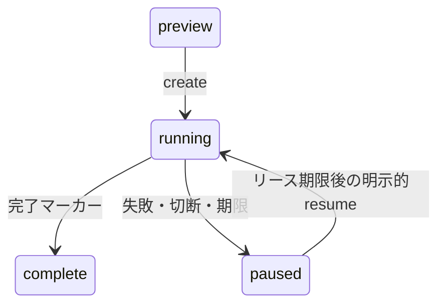

# PkgFactory 開発ガイド

保守者とコーディングエージェント向けです。利用者向けの説明は [README.md](README.md) にあります。

## 構成

npm workspacesで `packages/pkgfactory`（公開npmパッケージ）と `apps/cloudflare`（Worker）を管理します。

| パス | 責務 |
|---|---|
| `packages/pkgfactory/src/core` | 入力検証（Zod）、Mustacheによるファイル生成、プランの固定とハッシュ、名前規則、Markdownエスケープ |
| `packages/pkgfactory/src/github` | GitHub REST クライアント、Device Flow、Deploy key生成、Secretのsealed box、GitHub App導入状況 |
| `packages/pkgfactory/src/application` | `Factory`（プレビュー・作成・照合・再開）と `StateStore` |
| `packages/pkgfactory/src/node` | CLI、`FileStore`、ローカルWeb、資格情報の取得 |
| `packages/pkgfactory/src/web` | HTML、ブラウザー側スクリプト、`/api/*` ルート、共通のエラー応答 |
| `packages/pkgfactory/src/mcp` | MCPサーバー（stdio / Streamable HTTP） |
| `packages/pkgfactory/templates` | 4テンプレートの原本（81ファイル） |
| `apps/cloudflare/src` | Worker本体、OAuth、セッション、Durable Objects、レート制限、切断検出、テンプレート推薦 |
| `scripts` | ビルド、テンプレート埋め込み、E2E、配備確認 |
| `test` | Nodeテストとworkerdテスト |

`core`・`github`・`application` はNode固有APIを使わず、NodeとCloudflare Workersの両方で動きます。

### ビルド

`scripts/build.mjs` は次を行います。

1. `templates/` を `src/core/templates.json` に埋め込む（`scripts/templates.mjs`。Gitには含めない）
2. ブラウザー側スクリプト、CSS、画像を `src/web/assets.json` に埋め込む
3. `dist/cli.js`、`dist/index.js`、型定義、`apps/cloudflare/dist/worker.js` を生成する
4. `README.md` と `LICENSE` をパッケージへコピーする

`templates.json` は `npm ci`、`typecheck`、`test`、`e2e`、`build`、`npm pack` の前に自動生成されます。`tsx` でソースを直接実行する前には `npm run templates` を実行してください。

## プラン

`planPackage(spec)` は次を決めます。

- `id`: プランID（UUID）
- `uuid`: Project.tomlのUUID
- `createdAt`: 生成日時。ライセンス年とCITATIONの日付に使う
- `files`: 全ファイルの内容。`src/PKG.jl` と `examples/PKG.ipynb` はパッケージ名に置換する
- `digest`: `{spec, uuid, files}` のSHA-256
- `.pkgfactory.json`: 回復マーカー。`planId`、`digest`、`uuid`、`state`、Project.tomlのSHA-256を持つ

`validatePlan` は同じ入力と固定値から再生成して一致を確かめます。CLIの `--plan` はこの検証を通してから使います。

説明文は3通りに描画します。README向けはCommonMarkの記号をバックスラッシュでエスケープし、Documenter向けは固定の `@raw html` ブロック内のテキストとして `&<>` と記号をエンティティ化し、GitHubのdescriptionには原文を使います。

## 状態



| 項目 | 値 |
|---|---|
| プレビュー・完了結果の保持 | 15分 |
| subjectごとの保存プラン数 | 16 |
| 同時実行数 | 8 |
| 実行リース | 150秒 |
| 実行全体の期限 | 120秒 |
| GitHub要求ごとの期限 | 30秒 |

`subject` はGitHubユーザーIDです。実行前に `/user` を読み、保存されたsubjectと一致しないプランは拒否します。Nodeローカルアダプターはsubjectを `local` とし、この照合を省きます。
`paused` と `running` の記録は期限削除の対象外です。リース期限は再開を許可する時刻です。

| ストア | 用途 | 排他 |
|---|---|---|
| `MemoryStore` | ライブラリ埋め込み、テスト | Promiseチェーンによる直列化 |
| `FileStore` | CLI、ローカルWeb、stdio MCP | `journal.lock` と一時ファイルのrename。複数プロセスで同じディレクトリを共有できる |
| `DurableStore` | 公開Web・MCP | SQLite Durable Object `ApplicationState` でのCAS更新（最大20回再試行） |

`ApplicationState` はメタデータと不変プランを別カラムに保存し、subject・リポジトリ・実行中リースに索引を置きます。
トランザクションは自分のsubjectの記録と、排他判定に必要な他subjectの記録だけを読みます。
旧KV形式の記録は初回起動時に移行し、プラン本体が欠けた記録は `recoveryError: 'missing_plan'` として隔離します（実行と期限削除を拒否し、ジャーナルとロックは残す）。

## 作成手順

`Factory.execute` は次の順に進みます。各GitHub書き込みの前に `pending` をジャーナルへ保存し、成功後にチェックポイントを保存します。

1. 現在のGitHub状態を読む（リポジトリ、default branchのhead、回復マーカー、Deploy key、`DOCUMENTER_KEY`、Pages）
2. リポジトリを作成する。descriptionには一時的に `PkgFactory setup <planId>` を置く
3. Contents APIでREADMEを置き、`main` を初期化する。コミット名は `Using PkgFactory`
4. 全ファイルのtreeとコミットを作り、`main` を非強制で更新する。このコミットには `[skip ci]` を付ける
5. default branchを `main`、descriptionを利用者の入力に変更する
6. トピック `julia`、`juliapackagefactory` を追加する（既存のトピックは保持）
7. `simple` / `all-in-one` のみ: `gh-pages` ブランチ、Deploy key（書き込み可）、sealed boxで暗号化した `DOCUMENTER_KEY`、Pages（`gh-pages` の `/`）を設定する
8. 回復マーカーの `state` を `complete` に更新する。このコミットでpush CIが1回起動する

各段階は既存の状態を読んでから書くため、再開時は未完了の段階だけを実行します。

## 再開

通信例外、5xx、応答の読み取り失敗、429は結果不明として扱います。
切断や期限で `AbortSignal` が発火すると、以後のGitHub要求を送らず、ジャーナルの保存だけを行います。送信済みの要求がGitHubで完了した可能性は残ります。

`resume` は次を照合してから再開します。

- 保存したリポジトリIDと現在のIDが一致する
- 回復マーカーの `planId` と `digest` がプランと一致する。マーカーがなければ、descriptionが `PkgFactory setup <planId>` である
- マーカーがある場合、Project.tomlのSHA-256がマーカーの値と一致する
- `main` が記録したコミットから進んでいない

いずれかが一致しなければ拒否します。
Secretは読み戻せないため、登録結果が不明なら新しい鍵ペアを作り直します。古い鍵は、そのプランが作ったもの（`PkgFactory:<planId>:` で始まるタイトル）だけを、Secret登録の成功後に削除します。

鍵はWeb Cryptoで生成し、Ed25519はOpenSSH形式、RSA-4096はPKCS#1 PEM形式に変換します。
`DOCUMENTER_KEY` の値は秘密鍵PEMのBase64で、GitHubにはlibsodium互換のsealed boxで暗号化して送ります。

## Cloudflare Worker

`apps/cloudflare/src/worker.ts` が一つのWorkerでWebとMCPを提供します。

| パス | 内容 |
|---|---|
| `/` `/app.js` `/style.css` `/assets/*` | Web画面 |
| `/auth/login` `/auth/callback` `/auth/logout` | WebのGitHub OAuth |
| `/api/*` | Web API。セッションCookieとCSRFトークンが必要 |
| `/api/template-suggestion` | 説明文からのテンプレート推薦 |
| `/mcp` | MCP（Streamable HTTP）。OAuthのBearerトークンが必要 |
| `/authorize` `/oauth/token` `/oauth/register` `/callback` | MCPクライアント向けOAuth（`@cloudflare/workers-oauth-provider`） |
| `/health` | `{service, status}`。`status` は `ok` または `maintenance` |

### Webセッション

- ログイン開始時、`state`・PKCE verifier・10分の期限をAES-256-GCMで暗号化し、`__Host-pkgfactory-login` Cookieに置く
- コールバックでCookieと `state` の一致と期限を検証し、`state` のハッシュを `AuthState` で一度だけ消費してから、認可コードを交換する
- トークンのスコープに `repo` と `workflow` があることを確認し、`/user` でユーザーIDを得る
- セッションはランダムIDとそのHMAC署名をCookie `__Host-pkgfactory-session` に置き、サーバーにはIDのハッシュをキーとして暗号化したセッションを8時間保存する。署名鍵と暗号鍵は `SESSION_KEY` からHKDFで別々に派生する
- 復号できないセッション（`SESSION_KEY` 変更後など）は未ログインとして扱う
- ログアウトはサーバーのセッションを削除し、GitHubのトークンをOAuth AppのAPIで失効させる

### MCP OAuth

- アクセストークンは1時間、refresh tokenは8時間。refresh時はGitHubの `/user` でユーザーIDの一致を確認する
- 同意画面はクライアント名、戻り先、ループバック・カスタムスキームの注意、CIMDクライアントのドメインを表示する
- 戻り先はHTTPS、ループバックへのHTTP、カスタムスキームに限る。動的登録と認可開始の両方で検査する
- JSON-RPCバッチと不正なJSONは400で拒否する。切断検出は `tools/call` 1件ごとに行う

### レート制限

| 対象 | キー | 上限 |
|---|---|---|
| `/auth/login` | 接続元 | 毎分20回（`AuthState` のカウンター） |
| 匿名ルート（OAuth関連と `/auth/*`） | 接続元 | 毎分120回（`SOURCE_RATE_LIMIT`） |
| `/oauth/register` | 接続元 | 上記に加えて毎分10回（`REGISTRATION_RATE_LIMIT`） |
| `/api/*` と `/mcp` | GitHubアカウント | 毎分120回（`ACCOUNT_RATE_LIMIT`） |

接続元はIPv4アドレスまたはIPv6 /64の鍵付きハッシュです。Workers Rate Limitingは拠点ごとの概算です。

### 切断検出

`/api/create`、`/api/resume`、MCPの `tools/call` は、応答を先に開き、50ms間隔と各GitHub要求の直前に空白を書き込んで接続を確かめます。
書き込みに失敗すると `AbortSignal` を発火し、以後のGitHub要求を止めます。
この応答ではHTTP 200のまま本文に `error`（MCPでは `isError`）が入ることがあります。

### 起動時の検査

`/health` 以外のルートは、次が揃っていなければ503を返します。

- `GITHUB_OAUTH_CLIENT_ID` と `GITHUB_OAUTH_CLIENT_SECRET`
- Base64で復号して32バイトになる `SESSION_KEY`
- 3つのレート制限バインディング

`MAINTENANCE=true` のとき、`/mcp`、`/api/create`、`/api/resume` は503を返します。

### ログ

Workers Logsにはイベント名・メソッド・パスだけを記録します（`rate_limited`、`origin_rejected`、`csrf_rejected`、`redirect_rejected`、`registration_rejected`、`github_revoke_failed`、`oauth_error`、`template_suggestion_failed`）。
invocationログは無効にし、URLのクエリ文字列は削除します。

### テンプレート推薦

`/api/template-suggestion` は `AI` バインディングで `typesafe/jev` の `choice` 質問を呼び、4テンプレートの選択と確率を返します。
`typesafe/jev` はサードパーティーモデルのため、AI GatewayのUnified Billingを使います（`gateway: {id: 'default', collectLog: false}`）。配備先アカウントにクレジットを追加してください。
ブラウザー側の要求は1ページあたり10回までです。失敗時は `template_suggestion_failed` イベントに `reason`、`upstreamStatus`、検証パスを記録します。

## 配備

設定は `apps/cloudflare/wrangler.jsonc` にあり、トップレベルがステージング、`env.production` が本番です。

| 環境 | Worker名 | URL |
|---|---|---|
| ステージング | `pkgfactory-staging` | https://pkgfactory-staging.ohnolab.workers.dev |
| 本番 | `pkgfactory` | https://pkgfactory.ohnolab.workers.dev |

| 種別 | 名前 | 内容 |
|---|---|---|
| var | `ORIGIN` | Workerの公開origin。Host・Origin・Cookieの検証に使う |
| var | `GITHUB_OAUTH_CLIENT_ID` | GitHub OAuth AppのClient ID |
| var | `KEY_ALGORITHM` | `ed25519`（既定）または `rsa4096` |
| var | `MAINTENANCE` | `true` で作成と再開を止める |
| secret | `GITHUB_OAUTH_CLIENT_SECRET` | GitHub OAuth AppのClient secret |
| secret | `SESSION_KEY` | 乱数32バイトのBase64 |
| KV | `OAUTH_KV` | OAuth providerのクライアント・grant・トークン |
| Durable Object | `STATE` (`ApplicationState`) | プランとジャーナル |
| Durable Object | `AUTH` (`AuthState`) | セッション、ログイン制限、state消費 |
| Rate limit | `SOURCE_RATE_LIMIT` `REGISTRATION_RATE_LIMIT` `ACCOUNT_RATE_LIMIT` | 上記のレート制限 |
| AI | `AI` | テンプレート推薦 |

`ratelimits` の `namespace_id` はCloudflareアカウント内で一意にし、ステージングと本番で別の値を使います。

### GitHub OAuth App

環境ごとに1つ作ります。

| 設定 | 値 |
|---|---|
| Homepage URL | Workerのorigin |
| Authorization callback URL | `<origin>/auth/callback`（Web）と `<origin>/callback`（MCP） |
| Enable Device Flow | 本番は無効。公開Client IDだけで開始でき、本番アプリ名を使ったフィッシングに使えるため |
| Expire user access tokens | 有効 |

CLIの `--device` には、Device Flowを有効にした別のOAuth Appを使います。

### Secretの登録

ステージングはトップレベル、本番は `--env production` を付けます。付け忘れるとステージングを上書きします。

```sh
npx wrangler secret put GITHUB_OAUTH_CLIENT_SECRET --config apps/cloudflare/wrangler.jsonc --env production
node -e "process.stdout.write(require('node:crypto').randomBytes(32).toString('base64'))" \
  | npx wrangler secret put SESSION_KEY --config apps/cloudflare/wrangler.jsonc --env production
npx wrangler secret list --config apps/cloudflare/wrangler.jsonc --env production
```

`SESSION_KEY` は環境ごとに別の値を使います。変更すると既存のWebセッションは復号できなくなり、利用者はログインし直します。
新しい環境ではKVも作成し、返されたIDを `kv_namespaces[0].id` に設定します。

```sh
npx wrangler kv namespace create PKGFACTORY_TS_PRODUCTION_OAUTH --config apps/cloudflare/wrangler.jsonc --env production
```

### ワークフロー

| ワークフロー | 契機 | 内容 |
|---|---|---|
| `ci.yml` | PR、mainへのpush、手動 | Nodeテスト、workerdテスト、tarballの検証、4テンプレートのJulia実行。mainで全ジョブ成功後にステージングへ配備し、`/health` を確認する |
| `production.yml` | mainから手動 | 起動時点のmainがステージングへ配備済みかを `scripts/release-revision.ts` で照合してから本番へ配備し、`/health` を確認する |
| `release.yml` | mainから手動、確認欄に `publish` | `staging` の再配備、または `npm publish --provenance` |
| `template-repositories.yml` | mainのテンプレート関連変更、手動 | 固定4リポジトリの更新 |

ステージング配備は直前にmainの先頭が対象コミットのままであることを確認します。本番配備は `wrangler.jsonc` に `CONFIGURE_` が残っていればCloudflareへ接続する前に失敗します。

GitHubの `staging` / `production` environmentには、Cloudflareの **Edit Cloudflare Workers** 権限を持つAPIトークンを `CLOUDFLARE_API_TOKEN`（secret）、Account IDを `CLOUDFLARE_ACCOUNT_ID`（variable）として登録し、deployment branchを `main` に限定します。
`npm` environmentには承認者を設定し、npmのTrusted Publishingを `release.yml` と `npm` environmentに結び付けます。

ローカルから配備するには `npm run deploy:staging` / `npm run deploy:production` を使います。

## テスト

| 層 | コマンド | GitHubへの書き込み |
|---|---|---|
| 型検査 | `npm run typecheck` | なし |
| Nodeテスト | `npm test` | なし。GitHubは模擬サーバー（`test/fake-github.ts`）。鍵形式の検証に `ssh-keygen` が必要 |
| workerdテスト | `npm run test:worker` | なし。Miniflare上でWorker全体を実行する |
| tarball検証 | `node scripts/pack-smoke.mjs` | なし。`npm pack` の成果物をインストールしてCLI・stdio MCP・ローカルWebを起動する |
| 生成パッケージのJulia実行 | CI `generated-julia` ジョブ | なし。4テンプレートで `Pkg.test` を行い、`simple` と `all-in-one` ではdocsビルドで説明文が実行されないことを確認する |
| 固定リポジトリE2E | `npm run e2e:templates` | 既存4リポジトリへの差分commit/push |
| 作成・再開の受入 | `npm run e2e`、`npm run e2e:staging` | 1回の実行で新規リポジトリ1件まで |

`npm run check` は型検査、Nodeテスト、ビルド、workerdテストをまとめて実行します。

Nodeテスト（`test/*.test.ts`）の対象: 説明文のエスケープと名前規則（`core`）、切断・他subject・競合・改変の拒否（`engine`）、プロフィールと組織オーナー判定（`github-context`）、ローカルWebと `FileStore` とstdio MCP（`local`）、Streamable HTTP（`mcp-http`）、セッション・同意画面・戻り先・PKCE（`auth`）、jsdomでのブラウザー側の挙動（`web-workflow`、`web-interactions`）、Jev応答の検証（`template-suggestion`）、本番配備前の照合（`release`）、ローカルGitでの固定リポジトリ更新（`e2e-repositories`）。

workerdテスト（`test/worker/*.test.ts`）の対象: テンプレート生成のNodeとの一致、鍵生成とsealed box、ルートとDurable Objectの永続化、OAuth PKCEとCSRF、切断後の停止、ネイティブfetchでのWeb/MCP認可と4テンプレートの作成（`runtime`）、subjectごとの容量分離、旧形式の移行、欠損プランの隔離、ログインとアカウントのレート制限、`SESSION_KEY` の鍵長（`security`）。

### 固定リポジトリE2E

`scripts/template-repositories.ts` が4つの専用リポジトリを現在の生成器で更新します。

| テンプレート | リポジトリ |
|---|---|
| `minimum` | [ExampleMinimum.jl](https://github.com/JuliaPackageFactory/ExampleMinimum.jl) |
| `simple` | [ExampleSimple.jl](https://github.com/JuliaPackageFactory/ExampleSimple.jl) |
| `all-in-one` | [ExampleAllInOne.jl](https://github.com/JuliaPackageFactory/ExampleAllInOne.jl) |
| `agentic` | [ExampleAgentic.jl](https://github.com/JuliaPackageFactory/ExampleAgentic.jl) |

- 既存のUUIDとGit履歴を維持し、日付はリポジトリの最初のコミットから取る
- 生成物にないファイルは削除する。回復マーカー `.pkgfactory.json` は含めない
- 生成内容が同じならコミットしない。コミット名は `Update <Package> from PkgFactory.ts <生成元SHA>`
- dirty checkout、別のパッケージ名、不正なUUID、remote mainの変化を検出すると停止する

```sh
npm run e2e:templates -- --gh                              # 読み取りのみ。生成内容を .tmp/template-repositories/ に出力
npm run e2e:templates -- --gh --publish                    # 4件を更新
npm run e2e:templates -- --gh --publish --package=ExampleSimple
```

結果は `artifacts/template-repositories*.json` に保存します。

GitHub Actionsの `Template E2E tests` は、mainへのテンプレート関連の変更で1件ずつ更新し、その後に公開用トークンを渡さずにJuliaのテストを行い、`simple` と `all-in-one` ではdocsビルドも行います。有効化には次が必要です。

1. 対象4リポジトリに限定したfine-grained PAT（Contents: Read and write、Workflows: Read and write、Metadata: Read-only）をActions secret `PKGFACTORY_E2E_TOKEN` に登録する。固定リポジトリを追加したときは、既存PATのRepository accessにも加える
2. Actions variable `PKGFACTORY_TEMPLATE_E2E_ENABLED` を `true` にする

### 作成・再開の受入

新規作成は `JuliaPackageFactory/TestYYYYMMDDHHMMSS.jl`（UTC）を1回の実行で1件だけ作ります。失敗や結果不明も1件に数え、保存したplanIdで再開します。

```sh
# Node（状態は .tmp/e2e-state、記録は artifacts/github-e2e-*.json）
npm run e2e -- --gh --template=simple --confirm-create-test-repository
npm run e2e -- --gh --resume-plan=PLAN_ID --confirm-resume

# ステージングの公開MCP（OAuth認可をブラウザーで行う。引数なしでは8同時プレビューのみ）
npm run e2e:staging
npm run e2e:staging -- --template=all-in-one --confirm-create-test-repository
npm run e2e:staging -- --resume-plan=PLAN_ID --confirm-resume
# 作成中にHTTP接続を切り、停止・照合・明示的再開を確認する
npm run e2e:staging -- --template=simple --confirm-create-test-repository --confirm-disconnect-and-resume
```

ステージングの記録は `artifacts/staging-{mcp,disconnect,resume}-*.json` に保存します。

Deploy keyの実機検証には、その実行で作ったリポジトリに手動実行のワークフローを追加し、TagBotのSSH設定とタグpushを実行します。

```sh
npx tsx scripts/install-key-poc.ts JuliaPackageFactory/TestYYYYMMDDHHMMSS.jl --confirm
npm run poc   # Ed25519 / RSA-4096 の鍵生成の計測
```

## 運用

- **メンテナンス:** `MAINTENANCE=true` で配備すると作成と再開を止めます。この応答はGitHubの操作を始める前に返ります。
- **残存ロック:** `status` で照合し、リース期限後に `resume` で再開します。照合に失敗した場合はリポジトリを手動で確認します。ローカルの `journal.lock` は、記録されたPIDが終了していることを確認できた場合にだけ取り除けます。
- **認証エラー:** `code` が `oauth_client_credentials` ならClient IDとsecretの組、`oauth_redirect_uri` なら登録済みcallback URL、`oauth_code_invalid` ならコードの期限切れ・再利用、`oauth_scopes` なら `repo`/`workflow` の付与を確認します。
