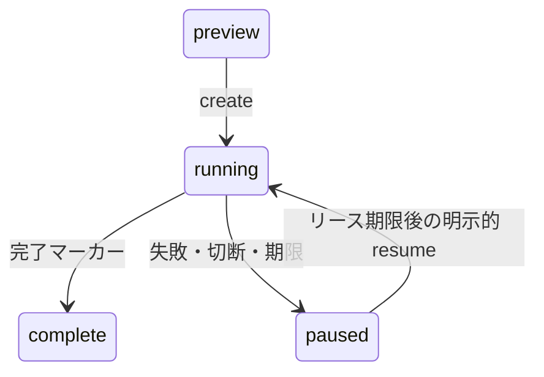

# 構成

npm workspacesで `packages/pkgfactory`（公開npmパッケージ）と `apps/cloudflare`（Worker、非公開）を管理します。

| パス | 責務 |
|---|---|
| `packages/pkgfactory/src/core` | 入力検証（Zod）、Mustacheによるファイル生成、プランの固定とハッシュ、名前規則、Markdownエスケープ |
| `packages/pkgfactory/src/github` | GitHub REST クライアント、Device Flow、Deploy key生成、Secretのsealed box、GitHub App導入状況 |
| `packages/pkgfactory/src/application` | `Factory`（プレビュー・作成・照合・再開）と `StateStore` インターフェース |
| `packages/pkgfactory/src/node` | CLI、`FileStore`、ローカルWeb、PAT/`gh`/Device Flowの資格情報取得 |
| `packages/pkgfactory/src/web` | HTML、ブラウザー側スクリプト、`/api/*` ルート、共通のエラー応答 |
| `packages/pkgfactory/src/mcp` | MCPサーバー（stdio / Streamable HTTP） |
| `packages/pkgfactory/templates` | 3テンプレートの原本（58ファイル） |
| `apps/cloudflare/src` | Worker本体、OAuth、セッション、Durable Objects、レート制限、切断検出、テンプレート推薦 |
| `scripts` | ビルド、テンプレート埋め込み、E2E、配備確認 |
| `test` | Nodeテスト（`npm test`）とworkerdテスト（`npm run test:worker`） |

`core` と `github` と `application` はNode固有APIに依存せず、NodeとCloudflare Workersの両方で動きます。
ビルド（`scripts/build.mjs`）はテンプレートとブラウザー資産をJSONに埋め込み、CLI・ライブラリ・Workerをesbuildでバンドルします。

## プラン

`planPackage(spec)` は入力から次を決めます。

- `id`: プランID（UUID）
- `uuid`: Project.tomlのUUID
- `createdAt`: 生成日時。ライセンス年とCITATIONの日付に使う
- `files`: 全ファイルの内容。パス `src/PKG.jl` と `examples/PKG.ipynb` はパッケージ名に置換する
- `digest`: `{spec, uuid, files}` のSHA-256
- `.pkgfactory.json`: 回復マーカー。`planId`、`digest`、`uuid`、`state`、Project.tomlのSHA-256を持つ

`validatePlan` は同じ入力と固定値から再生成して一致を確かめます。CLIの `--plan` で読み込んだプランはこの検証を通してから使います。

説明文は3通りに描画します。README向けはCommonMarkの記号をバックスラッシュでエスケープし、Documenter向けは固定の `@raw html` ブロック内のテキストとして `&<>` と記号をエンティティ化します。GitHubのdescriptionには原文を使います。利用者の入力からDocumenterのブロックやHTMLを挿入することはできません。

## 状態

| 項目 | 値 |
|---|---|
| プレビュー・完了結果の保持 | 15分 |
| subjectごとの保存プラン数 | 16 |
| 同時実行数 | 8 |
| 実行リース | 150秒 |
| 実行全体の期限 | 120秒 |
| GitHub要求ごとの期限 | 30秒 |

`subject` はGitHubユーザーIDです。実行前に `/user` を読み、保存されたsubjectと一致しないプランは拒否します。Nodeローカルアダプターだけはsubjectを `local` とし、この照合を省きます。
`paused` と `running` の記録は時間だけでは削除しません。リース期限は再開を許可する時刻であって、ロックの解放ではありません。

### ストア

| ストア | 用途 | 排他 |
|---|---|---|
| `MemoryStore` | ライブラリ埋め込み、テスト | Promiseチェーンによる直列化 |
| `FileStore` | CLI、ローカルWeb、stdio MCP | `journal.lock` と一時ファイルのrename。複数プロセスで同じディレクトリを共有できる |
| `DurableStore` | 公開Web・MCP | 単一のSQLite Durable Object `ApplicationState` でのCAS更新。リトライは20回 |

`ApplicationState` はメタデータと不変プランを別カラムに保存し、subject・リポジトリ・実行中リースに索引を置きます。
トランザクションは自分のsubjectの記録と、排他判定に必要な他subjectの記録だけを読みます。
旧KV形式の記録は初回起動時に移行し、プラン本体が欠けた記録は `recoveryError: 'missing_plan'` として隔離します（実行と期限削除を拒否し、ジャーナルとロックは残す）。

## 作成手順

`Factory.execute` は次の順に進みます。各GitHub書き込みの前に `pending` をジャーナルへ保存し、成功後にチェックポイントを保存します。

1. 現在のGitHub状態を読む（リポジトリ、default branchのhead、回復マーカー、Deploy key、`DOCUMENTER_KEY`、Pages）
2. リポジトリを作成する。descriptionには一時的に `PkgFactory setup <planId>` を置く
3. Contents APIでREADMEを置き、`main` を初期化する。コミット名は `Using PkgFactory`
4. 全ファイルのtreeとコミットを作り、`main` を非強制で更新する。このコミットには `[skip ci]` を付ける
5. default branchを `main`、descriptionを利用者の入力に変更する
6. トピック `julia`、`juliapackagefactory` を追加する（既存のトピックは保持）
7. `simple` / `all-in-one` のみ: `gh-pages` ブランチ、Deploy key（書き込み可）、sealed boxで暗号化した `DOCUMENTER_KEY`、Pages（`gh-pages` の `/`）を設定する
8. 回復マーカーの `state` を `complete` に更新する。このコミットでpush CIが1回起動する

各段階は既存の状態を読んでから書くため、再開時は未完了の段階だけを実行します。

## 中断と再開

通信例外、5xx、応答の読み取り失敗は結果不明として扱い、自動再送しません（429も同じ）。
切断や期限で `AbortSignal` が発火すると、以後のGitHub要求は送らず、ジャーナルの保存だけを行います。送信済みの要求がGitHubで完了した可能性は残ります。

`resume` は次を照合してから再開します。

- 保存したリポジトリIDと現在のIDが一致する
- 回復マーカーの `planId` と `digest` がプランと一致する。マーカーがなければ、descriptionが `PkgFactory setup <planId>` であること
- マーカーがある場合、Project.tomlのSHA-256がマーカーの値と一致する
- `main` が記録したコミットから進んでいない

いずれかが一致しなければ拒否し、既存のリポジトリを上書きしません。
Secretは読み戻せないため、登録結果が不明なら新しい鍵ペアを作り直します。古い鍵は、そのプランが作ったもの（`PkgFactory:<planId>:` で始まるタイトル）だけを、Secret登録の成功後に削除します。

## Cloudflare Worker

`apps/cloudflare/src/worker.ts` が一つのWorkerでWebとMCPを提供します。

| パス | 内容 |
|---|---|
| `/` `/app.js` `/style.css` `/assets/*` | Web画面 |
| `/auth/login` `/auth/callback` `/auth/logout` | WebのGitHub OAuth |
| `/api/*` | Web API。セッションCookieとCSRFトークンが必要 |
| `/api/template-suggestion` | 説明文からのテンプレート推薦（AIバインディングがある場合） |
| `/mcp` | MCP（Streamable HTTP）。OAuthのBearerトークンが必要 |
| `/authorize` `/oauth/token` `/oauth/register` `/callback` | MCPクライアント向けOAuth（`@cloudflare/workers-oauth-provider`） |
| `/health` | `{service, status}`。`status` は `ok` または `maintenance` |

### Webセッション

- ログイン開始時、`state`・PKCE verifier・10分の期限をAES-256-GCMで暗号化し、`__Host-pkgfactory-login` Cookieに置く。サーバー側には認可待ちの記録を持たない
- コールバックでCookieと `state` の一致と期限を検証し、`state` のハッシュを `AuthState` で一度だけ消費してから、認可コードを交換する
- トークンのスコープに `repo` と `workflow` があることを確認し、`/user` でユーザーIDを得る
- セッションはランダムIDとそのHMAC署名をCookie `__Host-pkgfactory-session` に置き、サーバーにはIDのハッシュをキーとして暗号化したセッションを8時間保存する。署名鍵と暗号鍵は `SESSION_KEY` からHKDFで別々に派生する
- 復号できないセッション（`SESSION_KEY` 変更後など）は未ログインとして扱う
- ログアウトはサーバーのセッションを削除し、GitHubのトークンをOAuth AppのAPIで失効させる

### MCP OAuth

- アクセストークンは1時間、refresh tokenは8時間。refresh時はGitHubの `/user` でユーザーIDの一致を確認する
- 同意画面はクライアント名、戻り先、ループバック・カスタムスキームの注意、CIMDクライアントのドメインを表示する
- 戻り先はHTTPS、ループバックへのHTTP、カスタムスキームに限る。動的登録と認可開始の両方で検査する
- JSON-RPCバッチと不正なJSONは400で拒否する。切断検出は `tools/call` 1件ごとに行うため
- MCPのgrantが持つGitHubトークンはWebセッションとは別で、Webのログアウトでは失効しない

### レート制限

| 対象 | キー | 上限 |
|---|---|---|
| `/auth/login` | 接続元 | 毎分20回（`AuthState` の正確なカウンター） |
| 匿名ルート（OAuth関連と `/auth/*`） | 接続元 | 毎分120回（`SOURCE_RATE_LIMIT`） |
| `/oauth/register` | 接続元 | 上記に加えて毎分10回（`REGISTRATION_RATE_LIMIT`） |
| `/api/*` と `/mcp` | GitHubアカウント | 毎分120回（`ACCOUNT_RATE_LIMIT`） |

接続元はIPv4アドレスまたはIPv6 /64の鍵付きハッシュです。生のIPは保存しません。
Workers Rate Limitingは拠点ごとの概算で、一つの接続元の負荷を抑えるものです。

### 切断検出

`/api/create`、`/api/resume`、MCPの `tools/call` は、応答を先に開き、50ms間隔と各GitHub要求の直前に空白を書き込んで接続を確かめます。
書き込みに失敗すると `AbortSignal` を発火し、以後のGitHub要求を止めます。処理をQueuesや `waitUntil` に移すことはしません。
この応答ではHTTP 200のまま本文に `error`（MCPでは `isError`）が入ることがあります。クライアントはHTTPステータスだけで成否を判断できません。

### 起動時の検査

`/health` 以外のルートは、次が揃っていなければ503を返します。

- `GITHUB_OAUTH_CLIENT_ID` と `GITHUB_OAUTH_CLIENT_SECRET`
- Base64で復号して32バイトになる `SESSION_KEY`
- 3つのレート制限バインディング

`MAINTENANCE=true` のとき、`/mcp`、`/api/create`、`/api/resume` は503を返します。

### ログ

Workers Logsにはイベント名・メソッド・パスだけを記録します（`rate_limited`、`origin_rejected`、`csrf_rejected`、`redirect_rejected`、`registration_rejected`、`github_revoke_failed`、`oauth_error`、`template_suggestion_failed`）。
リクエストごとのinvocationログは無効にし、URLのクエリ文字列は削除します。IP、トークン、アカウントID、説明文、応答本文は記録しません。

## 鍵とSecret

Web Cryptoで鍵を生成し、Ed25519はOpenSSH形式、RSA-4096はPKCS#1 PEM形式に変換します。
`DOCUMENTER_KEY` の値は秘密鍵PEMのBase64で、GitHubにはlibsodium互換のsealed boxで暗号化して送ります。

## 既知の制限

- MCPのgrantを失効してもGitHubトークンは失効しない
- レート制限は拠点ごとの概算で、分散した大量の接続元に対する容量保証ではない
- 生成されるリポジトリのワークフローに含まれるActionsはコミットSHAで固定していない
- CloudflareとローカルのFileStoreの間に共通のロックはない。衝突はGitHub上のマーカーと非強制のref更新で検出する
